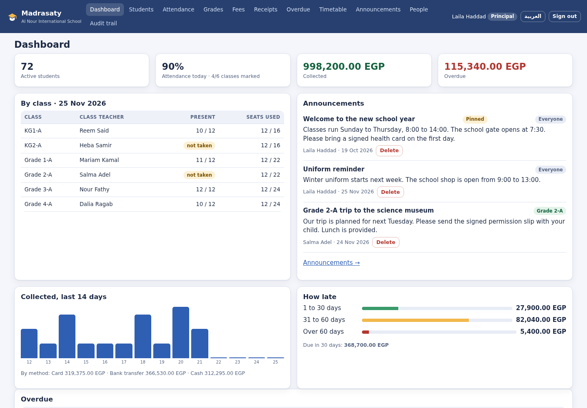
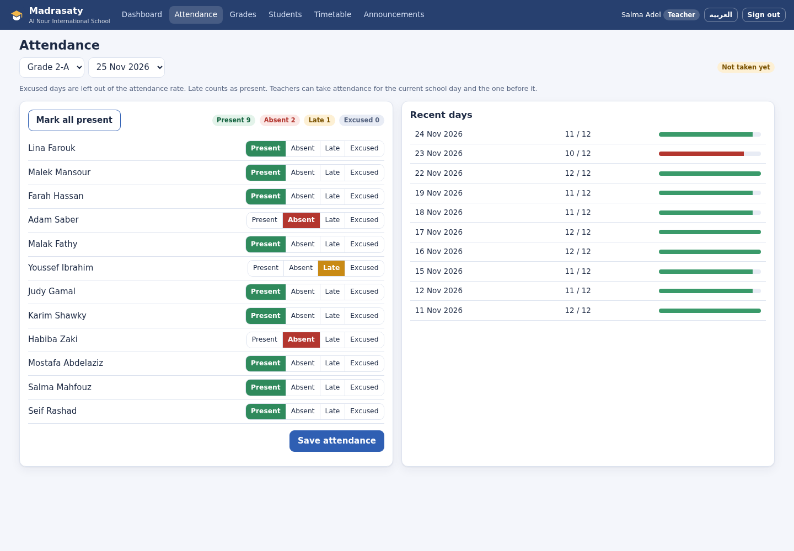
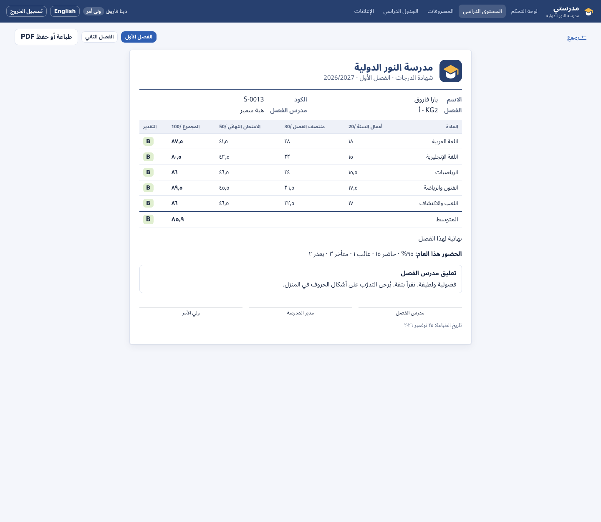
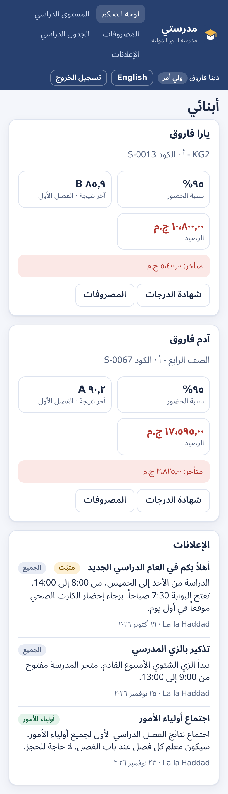

# Madrasaty (مدرستي)

Arabic / English school and nursery management demo. Students and classes, daily attendance, fee plans with installments, receipts and overdue tracking, grades with printable report cards, a parent portal, announcements, a timetable and four roles.

**Live demo:** https://madrasaty-three.vercel.app

Product direction by Nada Gamal. Implementation is AI-assisted, not hand-written by her.

## Demo accounts (PINs are shown on the sign-in screen)
| Role | PIN | Who |
|---|---|---|
| Admin | 1111 | Laila Haddad |
| Teacher | 2222 | Salma Adel, Grade 2-A |
| Accountant | 3333 | |
| Parent | 4444 | Dina Farouk (Yara in KG2, Adam in Grade 4) |

## Screenshots

A sample printable report card is in `docs/sample-report-card.pdf`.

## What it does
- Students, classes, guardians (72 students, 6 classes, 11 teachers in the seed).
- Daily attendance: the teacher sees only their class; attendance rate excludes excused days.
- Fee plans per level, installments, cash/transfer payments, internal receipts, overdue list and an in-app reminder notice.
- Grades by subject, term report card with remarks, printable as PDF.
- Parent portal: each child's progress, fees, announcements. Parents see only their own children.
- Announcements (pinned ones first), weekly timetable per class.
- Roles: admin, teacher, parent, accountant, each with its own permissions enforced on the server.
- Full Arabic (RTL) and English UI.

## Honest limits
- PINs are shown on the sign-in screen, and parent PINs are guessable. Demo only, not real authentication.
- No database. State is one shared JSON document that resets every 6 hours. With Vercel Blob, two saves at the same moment can overwrite each other.
- The Vercel Blob quota on the hosting account was suspended when this was deployed, so the live demo currently keeps its state in the memory of the running server instance and resets when that instance restarts (the code uses Blob automatically when it is available).
- Server error messages are English only, even in the Arabic UI.
- The report card PDF uses the browser's Print / Save as PDF (checked with a headless-browser PDF).
- No online payment. Receipts are internal, not tax-compliant invoices.
- No SMS or WhatsApp. The reminder is an in-app notice.
- No late fees, and refunds on withdrawal are out of scope.
- One class teacher per class; specialists grade their own subject.

## Tests
- `npm test`: 28 logic tests (fees, installments, attendance, grades, permissions, seed integrity).
- `node e2e/e2e.mjs <url>`: 71 browser checks (puppeteer) for all four roles, Arabic and English, mobile, printing. Run against the live URL: 71 passed, 0 failed. It resets the demo at the end.

## Layout
`public/` front end (vanilla JS, `logic.js` holds all rules shared by client, server and tests) · `api/data.js` one serverless function · `test/`, `e2e/` · `docs/`.

## Deploy
Vercel project with the `api/` function and optional Blob store (`BLOB_READ_WRITE_TOKEN`). `node dev-server.mjs` runs it locally.

## Built with AI assistance
Implementation was written with AI assistance. Nada Gamal set the product direction and requirements.
